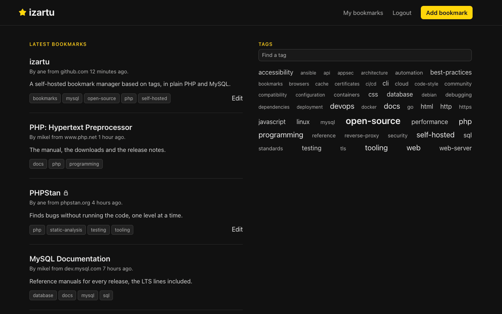
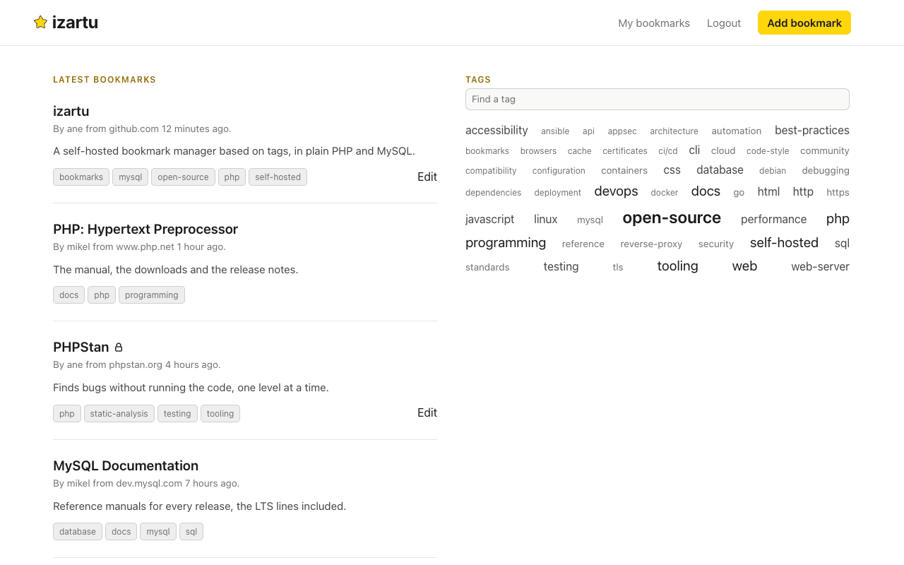
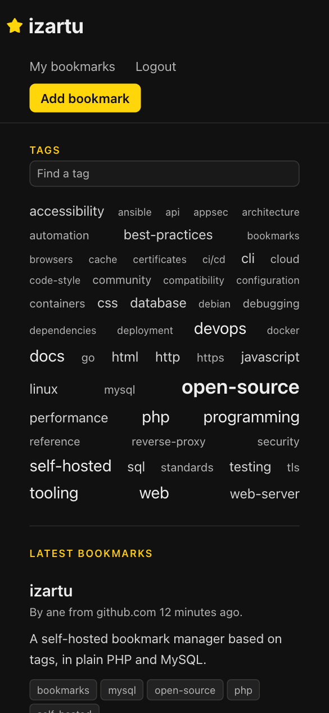
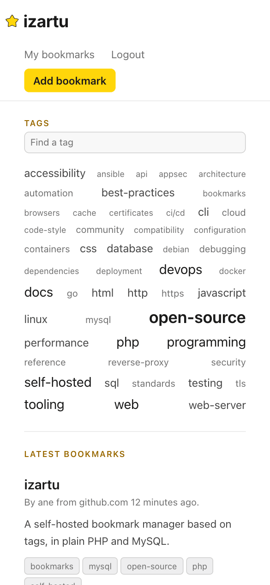

# izartu

[![Tests][b-tests]][w-tests] [![Lint and static analysis][b-lint]][w-lint] [![Security analysis][b-sec]][w-sec]

izartu is a lightweight, self-hosted web bookmark manager based on tags: your bookmarks are private by default, and
making one public shares it on your instance's feed.

[Website](https://izartu.org) · [Code documentation](https://izartu.org/doc/)

<picture>
  <source media="(prefers-color-scheme: light)" srcset=".github/screenshots/app-desktop-light.webp">
  
</picture>

<details>
  <summary>In the other theme</summary>
  <picture>
    <source media="(prefers-color-scheme: light)" srcset=".github/screenshots/app-desktop-dark.webp">
    
  </picture>
</details>

<p>
  
  
</p>

## Features

* **Personal first, social second.** Every bookmark is private (only you) or public (anyone on your instance); the
  public feed, the tag pages and the tag cloud emerge from personal use.
* **Self-contained.** No framework to upgrade, no build step, nothing to `npm install`: a production install is these
  files, PHP and MySQL.
* **Yours.** Self-hosted and AGPL-licensed: your bookmarks live on your server, and so does the public layer, scoped to
  your instance.
* A public feed anyone can browse, newest first and paginated; each bookmark shows who added it and when, with the exact
  date on hover.
* Filters by tags (`/tag/php,docs` lists the bookmarks carrying both) and by user (`/user/USERNAME`); the tag cloud
  describes the list on screen, and its links narrow it.
* A tag index (`/tags`), paginated and searchable, scoped to the list it was opened from; the search ignores accents and
  case.
* Bookmarks added, edited and deleted inline, in the list itself; your own page (`/user/me`) lists all of yours, public
  and private.
* Tags typed comma-separated and normalised: spaces trimmed and collapsed, lower-cased, duplicates dropped. Accents
  count: `café` and `cafe` are two tags.
* Dark and light themes, following the system, and a layout for narrow screens, where the tags come first.
* Runs at a domain root or in a sub-directory, detected from the request.
* Hardened sessions (HttpOnly, SameSite, Secure on HTTPS), CSRF-protected forms and escaped output.

## Status

izartu is being rebuilt toward its first release (v0.0) and has no published release yet. The core already works: login,
bookmark add/edit/delete with tags and visibility, and the public feed with pagination and tag filtering. Expect rough
edges and breaking changes while the rebuild is under way.

## Known limitations

* Users are managed from the command line only ([Managing users](#managing-users)): there are scripts to add a user,
  change their password and delete them, but none to list the users or change a role.
* No search over titles, links or descriptions: bookmarks are found by tag or by user.
* No import or export of bookmarks, no bookmarklet or browser extension, and no API: bookmarks are added in the web
  form.
* Login attempts are not rate limited: limit them in front of the app, in the web server or a reverse proxy.

## Requirements

izartu supports every PHP version with [security support](https://www.php.net/supported-versions.php), 8.2 to 8.5 today,
and MySQL 8.4 or later. CI runs the tests on each of those PHP versions against MySQL 8.4 and 9.7, the two LTS lines.

### With Docker

* Docker with the Compose plugin.

The stack runs PHP 8.5 with Apache and MySQL 9.7; [Configuration](#configuration) says how to choose other versions.

### Without Docker

* PHP, with the `pdo_mysql` and `mbstring` extensions.
* MySQL.
* A web server that routes every request to [`public/index.php`](public/index.php): Apache with `mod_rewrite`, through
  the shipped [`.htaccess`](public/.htaccess).

## Installation

### With Docker

1. Clone the repository:

   ```sh
   git clone https://github.com/javierbeaumont/izartu.git
   cd izartu
   ```

2. Choose the database credentials in a `.env` next to [`docker-compose.yml`](docker-compose.yml) (gitignored).
   `DB_USER` and `DB_PASS` are the app's MySQL account; `DB_ROOT_PASS` is the root password of the bundled MySQL, which
   izartu never reads:

   ```sh
   cat > .env <<'EOF'
   DB_USER=izartu
   DB_PASS=choose-a-password
   DB_ROOT_PASS=choose-another-password
   EOF
   ```

3. Start the stack. Every start applies the migrations the database lacks, so the first one builds the schema. It
   publishes the app on port 8080; `APP_PORT` in `.env` chooses another:

   ```sh
   docker compose up -d --build --wait
   ```

4. Create your first user, with the role `owner`:

   ```sh
   docker compose exec app php /var/www/izartu/private/cli/adduser.php
   ```

5. Open <http://localhost:8080>, or the port in `APP_PORT`, and log in at `/login`.

### Without Docker

1. Copy the repository to the server and point the web server's document root at `public/`; `private/` stays outside it.

2. Create an empty MySQL database and an account with every privilege on it: the migrations create and alter its tables.

3. Give the PHP process the `DB_*` settings ([Configuration](#configuration)). With Apache and mod_php, a minimal vhost:

   ```apache
   <VirtualHost *:80>
     ServerName bookmarks.example.org
     DocumentRoot /var/www/izartu/public
     AllowEncodedSlashes NoDecode

     <Directory /var/www/izartu/public>
       AllowOverride All
       Require all granted
     </Directory>

     SetEnv DB_USER user_name
     SetEnv DB_PASS user_password
   </VirtualHost>
   ```

   `AllowEncodedSlashes NoDecode` goes in the vhost because `.htaccess` cannot set it: without it, a tag with a `/` in
   its name links to a 404.

4. Build the schema. Like every script in [`private/cli/`](private/cli/), `migrate.php` reads the `DB_*` settings from
   its own environment:

   ```sh
   DB_USER=user_name DB_PASS=user_password php private/cli/migrate.php
   ```

5. Create the first user, with the role `owner`:

   ```sh
   php private/cli/adduser.php
   ```

6. Log in at `/login`.

izartu also runs from a sub-directory, such as `https://example.org/bookmarks/`, mounted with an `Alias` to `public/` or
a symlink to it: the base path is detected from the request.

## Upgrading

[Back up the database](#backups) first: migrations only go forward. [`migrate.php`](private/cli/migrate.php) applies, in
order, every migration the database lacks, and refuses a database it cannot continue from: one newer than the code, or
one it did not build. Until the migrations are applied, a page the old schema cannot serve answers 503, and PHP's error
log says to run `migrate.php`.

### With Docker

```sh
git pull                             # or check out the new release's tag
docker compose up -d --build --wait  # the app applies the new migrations on start
```

### Without Docker

1. Replace the files with the new release's.

2. Apply the new migrations:

   ```sh
   php private/cli/migrate.php
   ```

## Backups

The database holds all of izartu's data, so a dump of it is a full backup. Take it as MySQL's `root`: a consistent dump
that does not lock the tables needs more privileges than the app's account has. `--set-gtid-purged=OFF` leaves out the
server's transaction ids, which a restore does not need.

### With Docker

```sh
docker compose exec -T db sh -c \
  'MYSQL_PWD="$MYSQL_ROOT_PASSWORD" mysqldump --single-transaction --set-gtid-purged=OFF -u root izartu' > izartu.sql
docker compose exec -T db sh -c 'MYSQL_PWD="$MYSQL_ROOT_PASSWORD" mysql -u root izartu' < izartu.sql   # restore
```

### Without Docker

```sh
mysqldump --single-transaction --set-gtid-purged=OFF -u root -p izartu > izartu.sql
mysql -u root -p izartu < izartu.sql   # restore
```

## Configuration

[`private/config.php`](private/config.php) reads every setting from an environment variable, so a deployment never edits
tracked files:

| Setting          | Default                         | What it sets                            |
|------------------|---------------------------------|-----------------------------------------|
| `DB_USER`        | required                        | The app's MySQL account                 |
| `DB_PASS`        | required                        | Its password                            |
| `DB_HOST`        | `localhost`                     | MySQL's host                            |
| `DB_PORT`        | `3306`                          | MySQL's port                            |
| `DB_NAME`        | `izartu`                        | The database                            |
| `TIMEZONE`       | PHP's `date.timezone`, else UTC | The time zone of the dates shown        |
| `PAGE_SIZE`      | `10`                            | Bookmarks per feed page                 |
| `TAGS_PAGE_SIZE` | `100`                           | Tags per page of the tag index          |
| `CLOUD_SIZE`     | `50`                            | Tags in the cloud, the most used        |
| `BASE`           | detected from the request       | The base path: empty at a domain root   |
| `VERSION`        | read from the tree              | The running source, named in the footer |
| `DEBUG`          | off                             | Debug mode                              |

`TIMEZONE` takes a name from [PHP's list](https://www.php.net/timezones), such as `Europe/Madrid`; a name PHP does not
know stops the app.

`BASE` is `/bookmarks` for an install under that path; set it only behind a proxy that serves the app under a path the
request does not carry.

`VERSION` is what the footer names and links to as the running source. Unset, it comes from the tree: a release download
has it stamped in, and a clone reads it from its git metadata, even kept outside the tree
(`git clone --separate-git-dir`) as long as the web server can read it. Set it for a deploy that has neither; failing
all three, the footer links to the repository root.

`DEBUG=1` turns on debug mode: PHP's errors and the cause of a failed request on the page, a `Server-Timing` response
header with the request's metrics (PHP time, database time and query count, peak memory), which the browser's devtools
show in the network panel, and a collapsible panel at the bottom of every page that times each query and flags the
repeated ones. It shows errors to every visitor, so keep it off on a public instance.

### With Docker

The settings go in `.env`, except `DB_HOST`, `DB_NAME` and `DB_PORT`, which [`docker-compose.yml`](docker-compose.yml)
sets for the bundled MySQL. Three more shape the stack:

* `APP_PORT`: the port the app is published on, `8080` by default.
* `PHP_VERSION`: `8.5` by default.
* `MYSQL_VERSION`: `9.7` by default. Choose it before the first start: a database one MySQL version created may not
  start on an older one.

### Without Docker

The settings go in the web server's environment: `SetEnv` in the Apache vhost, or `env[...]` in the PHP-FPM pool. The
scripts in [`private/cli/`](private/cli/) read them from their own environment.

## Managing users

Users are managed from the command line, with three scripts in [`private/cli/`](private/cli/). Login is by email; the
username is the public display name shown next to the user's bookmarks and in the URL of their page, `/user/USERNAME`.

### Add a user

[`adduser.php`](private/cli/adduser.php) asks for the email, the username, the password (twice, without showing it on a
terminal) and the role, and stores only the password's hash. The email must be valid and the username 3-32 characters
(letters, digits, `_` or `-`), neither of them another user's; `me` is reserved, since `/user/me` is the alias for your
own page. A password needs at least 8 characters.

The role sets whose bookmarks a user may edit and delete: `owner` and `admin` any public one, `user` only their own. No
one sees another user's private bookmarks. `owner` and `admin` differ only in that the only owner cannot be deleted. An
empty role gives `user`, so type `owner` for the first user.

With Docker:

```sh
docker compose exec app php /var/www/izartu/private/cli/adduser.php
```

Without Docker:

```sh
php private/cli/adduser.php
```

### Change a password

[`passwd.php`](private/cli/passwd.php) asks for the email and the new password, twice, without showing it on a terminal,
and ends every session the user has open, so a leaked password stops working at once.

With Docker:

```sh
docker compose exec app php /var/www/izartu/private/cli/passwd.php
```

Without Docker:

```sh
php private/cli/passwd.php
```

### Delete a user

[`deluser.php`](private/cli/deluser.php) deletes a user with their bookmarks and the tags only that user's bookmarks
have. It asks for the email, shows the username, the role and how many bookmarks go with them, and deletes only once the
email is typed again. It ends the user's open sessions too.

With Docker:

```sh
docker compose exec app php /var/www/izartu/private/cli/deluser.php
```

Without Docker:

```sh
php private/cli/deluser.php
```

### Running the scripts without Docker

Each script reads the `DB_*` settings from its own environment, like `migrate.php`. `passwd.php` and `deluser.php` end a
user's sessions by deleting the web server's session files, so the web server must use PHP's default session handler,
which keeps them in files, and the scripts must run with its `session.save_path` (`php -d session.save_path=...` when
the command line's differs) and as a user who can list and delete those files: root, or the web server's user where the
directory lets it list them (Debian's `/var/lib/php/sessions` does not).

## Errors and logs

A request that fails because the database is unreachable or behind the code answers 503 with `Retry-After`; any other
failure answers 500. The cause goes to PHP's error log, and debug mode shows it on the page too, unless the app fails to
start (a `TIMEZONE` PHP does not know): that page is empty.

### With Docker

PHP's log goes to the app container's output, mixed with Apache's access log; its lines are tagged `php:`.

```sh
docker compose logs app | grep 'php:'
```

### Without Docker

PHP's log is the file `error_log` names in `php.ini` or, when it names none, the web server's error log.

## Contributing

See [CONTRIBUTING.md](CONTRIBUTING.md): what fits the project, how to report a bug or send a change, and how to run the
tests and checks. Report a vulnerability privately, as [SECURITY.md](SECURITY.md) explains. Everyone taking part follows
the [Code of Conduct](CODE_OF_CONDUCT.md).

## License

izartu is free software under the [GNU Affero General Public License](LICENSE), version 3 or any later version: if you
run a modified version as a network service, you must offer its source to the users who interact with it. The wordmark
is set in [Inter](https://rsms.me/inter/), by The Inter Project Authors, under the SIL Open Font License 1.1
([public/font/OFL.txt](public/font/OFL.txt)).

[b-tests]: https://github.com/javierbeaumont/izartu/actions/workflows/tests.yml/badge.svg
[w-tests]: https://github.com/javierbeaumont/izartu/actions/workflows/tests.yml
[b-lint]: https://github.com/javierbeaumont/izartu/actions/workflows/lint-and-static-analysis.yml/badge.svg
[w-lint]: https://github.com/javierbeaumont/izartu/actions/workflows/lint-and-static-analysis.yml
[b-sec]: https://github.com/javierbeaumont/izartu/actions/workflows/security-analysis.yml/badge.svg
[w-sec]: https://github.com/javierbeaumont/izartu/actions/workflows/security-analysis.yml
